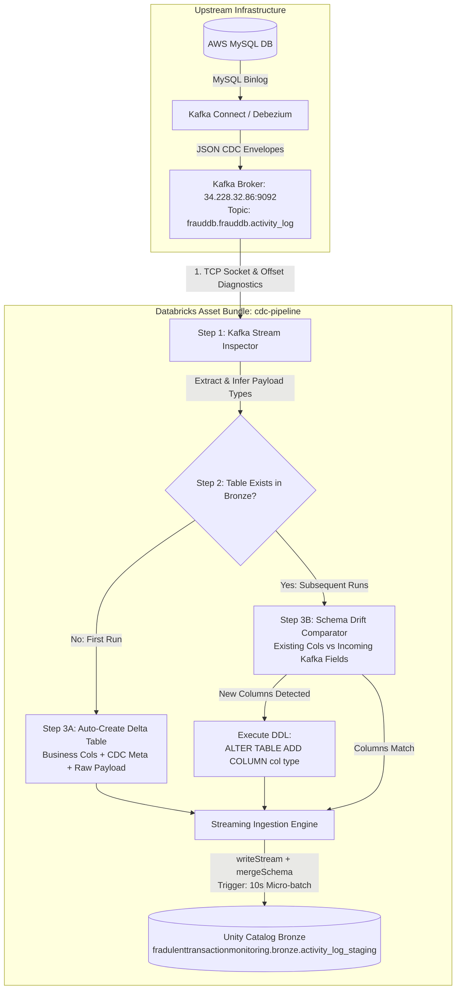

# Fraud Detection Pipeline: Metadata-Driven Kafka CDC Ingestion (DAB)

## Project Summary (In Simple Language)

This project is an automated, real-time data streaming pipeline that captures database changes from an online transactional database and streams them directly into a secure, organized data warehouse for fraud analysis.

### What It Does & How It Works
* **Where It Pulls Data From**:
  It reads from an **AWS MySQL database** (`frauddb.activity_log`) where user activity (such as logins, payments, and account actions) is recorded.
* **The CDC (Change Data Capture)**:
  Instead of repeatedly running heavy database queries, a tool called **Debezium** reads MySQL's internal transaction log (binlog) in real time. Whenever a row is inserted, updated, or deleted, Debezium instantly converts that change into an event message.
* **The Kafka Message Queue**:
  These CDC change messages are published to an **Apache Kafka topic** (`frauddb.frauddb.activity_log` at `34.228.32.86:9092`). Kafka acts as a shock absorber and buffer, holding the messages safely in order so nothing is ever dropped or lost.
* **The Cluster (Compute)**:
  The pipeline runs 24/7 on a single virtual machine in Azure Databricks (a **Single-Node cluster** with **4 CPU cores** and **16 GB RAM** running **Apache Spark 3.5**). It checks Kafka every 10 seconds for new messages and processes them in micro-batches without needing expensive multi-node worker clusters.
* **The Catalog (Where It Inserts Data)**:
  The data is unpacked, validated, and inserted into **Databricks Unity Catalog**:
  * **Catalog**: `fradulenttransactionmonitoring`
  * **Schema**: `bronze`
  * **Table**: `activity_log_staging` (a high-speed Delta Lake table stored on Azure Cloud Storage).
* **Self-Healing & Metadata-Driven**:
  * **Auto Table Creation**: If the table does not exist, the pipeline inspects the incoming Kafka messages, figures out the columns and data types, and creates the table automatically.
  * **Auto Column Sync**: If someone adds new columns to the upstream MySQL database, the pipeline detects the new fields and automatically runs `ALTER TABLE` in Databricks to add those missing columns before saving the data.

---

## End-to-End System Architecture

```
+---------------------------------------------------------------------------------------------------+
|                                     SOURCE: AWS INFRASTRUCTURE                                    |
|                                                                                                   |
|   +-----------------------+              +-----------------------+       +--------------------+   |
|   |   AWS MySQL Database  |              |    Kafka Connect      |       |    Apache Kafka    |   |
|   |  (frauddb.activity_log| ===binlog==> |  (Debezium Connector) | ====> | Broker: 34.228...  |   |
|   |      table rows)      |              |                       |       | Topic: activity_log|   |
|   +-----------------------+              +-----------------------+       +--------------------+   |
+-------------------------------------------------------------------------------------|-------------+
                                                                                      | TCP 9092
                                                                                      v
+---------------------------------------------------------------------------------------------------+
|                                  DESTINATION: AZURE DATABRICKS                                    |
|                                                                                                   |
|  +---------------------------------------------------------------------------------------------+  |
|  | [STAGE 1: LIGHTWEIGHT PRE-FLIGHT JOB] mysql_cdc_preflight                                  |  |
|  | Compute: Databricks Serverless (0 Azure VM Cores, 0 Startup Lag, Millisecond TCP Probe)     |  |
|  | Result: If Kafka is down -> HALTS & Skips Stage 2. (Zero VM cores or quota consumed!)       |  |
|  |         If Kafka is up   -> Authorizes and triggers Stage 2 downstream!                     |  |
|  +---------------------------------------------------------------------------------------------+  |
|                                                  |                                                |
|                                                  | (Only if Pre-flight Passes)                    |
|                                                  v                                                |
|  +---------------------------------------------------------------------------------------------+  |
|  | [STAGE 2: STREAMING INGESTION JOB] mysql_cdc_stream                                         |  |
|  | Compute: SingleNode Standard_D2ds_v6 (2 vCPUs, 8 GiB RAM, Spark 15.4 LTS)                    |  |
|  +---------------------------------------------------------------------------------------------+  |
|                                                  |                                                |
|   +----------------------------------------------v--------------------------------------------+   |
|   |                               METADATA-DRIVEN ENGINE LIFECYCLE                            |   |
|   |                                                                                           |   |
|   |  [STEP 1: KAFKA STREAM INSPECTION]                                                        |   |
|   |    - Socket reachability test (34.228.32.86:9092)                                         |   |
|   |    - Read batch snapshot: Total records, partition distribution, high-watermark offsets   |   |
|   |    - Unpack Debezium envelope (payload.after / payload.before)                            |   |
|   |    - Infer Spark SQL column types (BIGINT, DOUBLE, BOOLEAN, STRING)                       |   |
|   |                                                                                           |   |
|   |  [STEP 2: CHECK DATABRICKS TARGET TABLE]                                                  |   |
|   |    - Check Unity Catalog: fradulenttransactionmonitoring.bronze                           |   |
|   |    - Query catalog: Does 'activity_log_staging' exist?                                    |   |
|   |                     /                                \                                    |   |
|   |           Table DOES NOT Exist                  Table ALREADY Exists                      |   |
|   |                     |                                     |                               |   |
|   |  [STEP 3A: AUTO-PROVISION TABLE]               [STEP 3B: SCHEMA DRIFT CHECK & ALTER]      |   |
|   |    - Generate DDL combining:                     - Compare existing cols vs Kafka fields  |   |
|   |      * Discovered business columns               - If match: Ready for direct ingestion   |   |
|   |      * Full raw_payload (STRING)                 - If missing cols: Execute               |   |
|   |      * CDC operational metadata                    ALTER TABLE ... ADD COLUMN <col> <type>|   |
|   |      * Kafka stream audit metadata                                                        |   |
|   |    - Execute CREATE TABLE ... USING DELTA                                                 |   |
|   |                     \                                     /                               |   |
|   |                      +----------------+------------------+                                |   |
|   |                                       |                                                   |   |
|   |  [STREAMING INGESTION ENGINE]         v                                                   |   |
|   |    - Read continuous Kafka stream (startingOffsets: earliest, failOnDataLoss: false)      |   |
|   |    - Project typed business fields + CDC metadata + raw payload                           |   |
|   |    - Delta writeStream:                                                                   |   |
|   |        * Checkpoint Location: /Volumes/fradulenttransactionmonitoring/bronze/...          |   |
|   |        * Option: mergeSchema = true                                                       |   |
|   |        * Trigger: processingTime = '10 seconds'                                           |   |
|   |        * Target: fradulenttransactionmonitoring.bronze.activity_log_staging               |   |
|   +-------------------------------------------------------------------------------------------+   |
|                                                  |                                                |
|                                                  v                                                |
|  +---------------------------------------------------------------------------------------------+  |
|  |                DELTA LAKE BRONZE TABLE: activity_log_staging (29 Columns)                   |  |
|  |  [Business Entities]  id, event_id, event_type, user_id, amount, account_id, ip_address...  |  |
|  |  [CDC Lineage]        _cdc_op, _cdc_ts_ms, _cdc_source_db, _cdc_source_table, _binlog_pos  |  |
|  |  [Kafka Audit]        _kafka_topic, _kafka_partition, _kafka_offset, _kafka_timestamp       |  |
|  |  [Zero Data Loss]     raw_payload (Full unparsed JSON string preserving all raw records)   |  |
|  +---------------------------------------------------------------------------------------------+  |
+---------------------------------------------------------------------------------------------------+
```

---

## Visual Flow (Mermaid Diagram)



---

## Repository Structure & Folder Patterns

The project follows the official Databricks Asset Bundle (DAB) standard layout, cleanly separating infrastructure configuration, runtime metadata, source code, diagnostics, and testing:

```
cdc-pipeline/
├── databricks.yml                  # Root DAB infrastructure configuration
├── .gitignore                      # Git ignore file for Python cache & bundle builds
├── README.md                       # Comprehensive project documentation
├── ARCHITECTURE.md                 # Complete technical & architectural specification
├── INFRASTRUCTURE.md               # Plain-language infrastructure & tech stack summary
├── config/
│   └── pipeline_metadata.json      # Declarative metadata configuration
├── src/
│   ├── main.py                     # DAB Task CLI entry point & sys.path loader
│   └── cdc/
│       ├── __init__.py             # CDC package interface exports
│       ├── config.py               # Strongly-typed dataclass configuration models
│       ├── preflight.py            # Pre-flight environment, connectivity & fail-fast diagnostic checks
│       ├── kafka_client.py         # Network socket probe, offset probe, readStream builder
│       ├── schema_manager.py       # Table governance, dynamic DDL creation & ALTER TABLE sync
│       ├── stream_writer.py        # Stream transformation, CDC projection & Delta writer
│       └── pipeline.py             # 3-step orchestrator & post-ingestion audit query runner
├── notebooks/
├── 01_bronze_to_silver.py      # Databricks interactive notebook for Bronze -> Silver curation
└── 02_silver_to_gold.py        # Databricks interactive notebook for Silver -> Gold feature marts
├── scripts/
│   ├── check_kafka.py              # Standalone socket-based Kafka protocol offset & message inspector
│   └── validate_reconciliation.py  # Automated end-to-end source vs destination data reconciliation tool
└── tests/
    └── test_schema_manager.py      # Offline unit tests for type inference & schema diffing
```

### File & Folder Responsibilities

| Path | Component | Purpose |
| :--- | :--- | :--- |
| **`databricks.yml`** | DAB Root Definition | Declares bundle name, environment variables (`catalog`, `schema`, `table`, `trigger_mode`), target workspaces (`dev`, `prod`), continuous job triggers, and SingleNode cluster specs (`Standard_D2ds_v6`). |
| **`config/pipeline_metadata.json`** | Metadata Configuration | Central JSON configuration driving the pipeline: source Kafka connection, target Unity Catalog coordinates, checkpoint volume paths, and schema governance policies. |
| **`src/main.py`** | Application Entrypoint | Executable script invoked by Databricks Workflow tasks. Patches `sys.path` for driver execution, parses CLI parameters from `databricks.yml`, loads metadata, executes pre-flight checks, and triggers orchestrator with clean error handling. |
| **`src/cdc/__init__.py`** | Package Init | Exposes clean package imports (`PipelineConfig`, `CDCPipeline`, `PreflightChecker`, `PreflightException`, `KafkaClient`, `SchemaManager`, `StreamWriter`, `load_config`). |
| **`src/cdc/config.py`** | Config Dataclasses | Implements `@dataclass` models (`SourceConfig`, `TargetConfig`, `GovernanceConfig`, `PipelineConfig`) with hierarchical search-path discovery and environment variable support. |
| **`src/cdc/preflight.py`** | Pre-Flight Health Checker | Preliminary readiness suite that probes Kafka network reachability, Unity Catalog objects, and configuration invariants. Fails fast with clean, human-readable ASCII diagnostic boxes before Spark startup. |
| **`src/cdc/kafka_client.py`** | Kafka Engine (Step 1) | Performs pre-flight TCP reachability tests, bounded batch offset inspections, partition distribution counts, payload message sampling, and builds the PySpark `readStream`. |
| **`src/cdc/schema_manager.py`** | Table Governance (Step 2 & 3) | Validates Catalog/Schema/Volume presence, checks table existence, infers Spark types from JSON payloads, builds dynamic `CREATE TABLE` DDL, and runs `ALTER TABLE ... ADD COLUMN` when schema drift occurs. |
| **`src/cdc/stream_writer.py`** | Stream Transformer (Step 3) | Unpacks Debezium envelopes (`payload.after`/`payload.before`), preserves full `raw_payload`, injects CDC and Kafka metadata, configures Unity Catalog checkpoints, and executes `writeStream` with `mergeSchema`. |
| **`src/cdc/pipeline.py`** | Pipeline Orchestrator | Glues all components into an end-to-end 3-step lifecycle and performs automated post-ingestion verification queries. |
| **`notebooks/01_bronze_to_silver.py`** | Bronze -> Silver Notebook | Interactive Databricks notebook for CDC deduplication, Debezium delete handling, JSON payload unpacking, timestamp casting, and writing to `silver.activity_log_cleaned`. |
| **`notebooks/02_silver_to_gold.py`** | Silver -> Gold Notebook | Interactive Databricks notebook aggregating curated data into 3 Gold tables: `user_fraud_profile`, `hourly_fraud_metrics`, and `suspicious_device_mart`. |
| **`scripts/check_kafka.py`** | Diagnostic Tool | Zero-dependency socket utility to probe Kafka brokers, list partitions, and calculate high-watermark message counts directly from the local terminal. |
| **`scripts/validate_reconciliation.py`** | Reconciliation Engine | Automated diagnostic comparing Kafka offsets and Databricks Delta Lake records to prove zero data loss. |
| **`tests/test_schema_manager.py`** | Unit Test Suite | Standalone tests verifying type inference (e.g. `int -> BIGINT`, `float -> DOUBLE`), configuration parsing, and schema diffing with mock Spark SQL executions. |

---

## The 3-Step Metadata-Driven Engine Explained

### Step 1: Kafka Stream Inspection
1. **TCP Socket Pre-flight**: Directly connects to `34.228.32.86:9092` via raw Python sockets before starting Spark. If a firewall or security group blocks the port, it alerts immediately without waiting for Spark's 15-minute connection timeout.
2. **Snapshot Offset Diagnostics**: Executes a bounded batch query (`startingOffsets: earliest`, `endingOffsets: latest`) to calculate available records and high-watermarks across all partitions.
3. **Payload Structure & Type Inference**: Samples the newest messages. If Debezium's schema block is present, it maps types directly (`int32 -> INT`, `int64 -> BIGINT`, `double -> DOUBLE`). If raw JSON is sent, it evaluates Python runtime types using `infer_spark_type()`.

### Step 2: Target Table Existence Check
1. **Unity Catalog Environment**: Confirms the catalog `fradulenttransactionmonitoring` and schema `bronze` exist, creating schemas and checkpoint volumes as needed.
2. **Catalog Probe**: Calls `spark.catalog.tableExists("fradulenttransactionmonitoring.bronze.activity_log_staging")`.

### Step 3: Dynamic Table Creation & Schema Drift Evolution
- **If Table DOES NOT Exist**:
  - Dynamically synthesizes the Delta table DDL combining discovered business fields, audit metadata, and `raw_payload`.
  - Configures Delta Lake auto-compaction and optimized writes:
    ```sql
    CREATE TABLE IF NOT EXISTS fradulenttransactionmonitoring.bronze.activity_log_staging (
        `id` BIGINT,
        `event_id` STRING,
        `event_type` STRING,
        `user_id` BIGINT,
        ...
        `raw_payload` STRING,
        `_cdc_op` STRING,
        `_cdc_ts_ms` BIGINT,
        `_cdc_source_db` STRING,
        `_cdc_source_table` STRING,
        `_cdc_binlog_file` STRING,
        `_cdc_binlog_pos` BIGINT,
        `_kafka_key` STRING,
        `_kafka_topic` STRING,
        `_kafka_partition` INT,
        `_kafka_offset` BIGINT,
        `_kafka_timestamp` TIMESTAMP,
        `_ingested_at` TIMESTAMP
    )
    USING DELTA
    TBLPROPERTIES (
        'delta.autoOptimize.optimizeWrite' = 'true',
        'delta.autoOptimize.autoCompact' = 'true'
    )
    ```
- **If Table ALREADY Exists (Schema Drift Synchronization)**:
  - Compares existing columns against discovered incoming fields.
  - If a column was added upstream in MySQL (e.g. `ALTER TABLE activity_log ADD COLUMN ip_risk_score DOUBLE;`), the engine detects that `ip_risk_score` is missing in Databricks and runs:
    ```sql
    ALTER TABLE fradulenttransactionmonitoring.bronze.activity_log_staging ADD COLUMN ip_risk_score DOUBLE;
    ```
  - Along with `.option("mergeSchema", "true")`, this guarantees zero-downtime, non-breaking schema evolution.

---

## How Databricks Asset Bundle (DAB) Architecture is Utilized

Databricks Asset Bundles (DAB) enable Infrastructure-as-Code (IaC) and CI/CD for Databricks workflows.

### 1. Declarative Resource Parameterization (`variables`)
All operational parameters are declared under `variables` in `databricks.yml` and interpolated into task arguments (`${var.catalog}`, `${var.table}`, `${var.trigger_mode}`). This allows running different catalogs, tables, or topics in different environments without changing application code.

### 2. Reliable SingleNode Compute (`Standard_D2ds_v6`)
- Older VM types like `Standard_DS3_v2` frequently encounter Azure capacity stockouts (`SkuNotAvailable`), while 4-core types can hit strict free/standard core quota ceilings during restart overlaps.
- The bundle specifies **`Standard_D2ds_v6`** with **`num_workers: 0`** (SingleNode). SingleNode clusters provision a single 2-core VM (8 GiB RAM) that acts as both driver and executor (`local[*]`), maintaining a minimal sufficient footprint to stream transactions smoothly while strictly respecting Azure regional core limits.

### 3. Continuous 24/7 Streaming Orchestration
The job resource includes:
```yaml
continuous:
  pause_status: UNPAUSED
```
Databricks continuously monitors the streaming process. If an intermittent network glitch occurs, Databricks automatically restarts the job from its last recorded checkpoint offset stored in the Unity Catalog Volume.

---

## Deployment & Management Commands

### 1. Validate the Bundle
Verifies bundle syntax, variable interpolations, and Databricks workspace authentication:
```bash
databricks bundle validate
```

### 2. Deploy the Bundle
Synchronizes local code to the remote Databricks workspace under `/Workspace/Users/<email>/.bundle/cdc-pipeline/dev`:
```bash
# Deploy to development
databricks bundle deploy -t dev

# Deploy to production
databricks bundle deploy -t prod
```

### 3. Trigger / Run the Job
```bash
databricks bundle run mysql_cdc_stream -t dev --no-wait
```

### 4. Monitor Job Runs from the CLI
```bash
# List recent job runs
databricks jobs list-runs --job-id 1032328035575613 --limit 5

# Inspect run status
databricks jobs get-run <run_id>

# View live execution logs (Standard Output)
databricks jobs get-run-output <task_run_id>
```

### 5. Check Kafka Directly from Local Machine
Verify if messages are published to Kafka without spinning up Spark:
```bash
python3 scripts/check_kafka.py
```

### 6. Run Offline Unit Tests
```bash
PYTHONPATH=. python3 tests/test_schema_manager.py
```

---

## Data Verification & Audit SQL

Run these queries in the **Databricks SQL Editor** or any notebook to verify ingested data:

```sql
-- 1. Check total rows ingested
SELECT COUNT(*) AS total_bronze_records
FROM fradulenttransactionmonitoring.bronze.activity_log_staging;

-- 2. Inspect ingested records with Kafka offsets and CDC metadata
SELECT 
    _kafka_partition,
    _kafka_offset,
    _kafka_timestamp,
    _cdc_op,
    _cdc_ts_ms,
    _ingested_at,
    id,
    event_id,
    event_type,
    user_id,
    transaction_id,
    severity
FROM fradulenttransactionmonitoring.bronze.activity_log_staging
ORDER BY _kafka_offset DESC
LIMIT 10;

-- 3. Audit operation breakdown (Inserts, Updates, Deletes)
SELECT 
    CASE 
        WHEN _cdc_op = 'c' THEN 'Insert'
        WHEN _cdc_op = 'u' THEN 'Update'
        WHEN _cdc_op = 'd' THEN 'Delete'
        WHEN _cdc_op = 'r' THEN 'Snapshot Read'
        ELSE _cdc_op 
    END AS operation_type,
    COUNT(*) AS record_count
FROM fradulenttransactionmonitoring.bronze.activity_log_staging
GROUP BY _cdc_op;

-- 4. View transaction commit history & schema additions
DESCRIBE HISTORY fradulenttransactionmonitoring.bronze.activity_log_staging;
```

---

## Data Dictionary (Registered Bronze Table Columns)

| Column Name | Data Type | Source Layer | Description |
| :--- | :--- | :--- | :--- |
| **`id`** | BIGINT | Business Entity | Primary key identifier of the activity log entry. |
| **`event_id`** | STRING | Business Entity | Unique event UUID generated upstream. |
| **`event_type`** | STRING | Business Entity | Categorical classification of the event (e.g. `LOGIN`, `PAYMENT`). |
| **`event_time`** | STRING | Business Entity | Upstream event timestamp. |
| **`user_id`** | BIGINT | Business Entity | Unique user account identifier. |
| **`account_id`** | BIGINT | Business Entity | Associated financial account ID. |
| **`transaction_id`** | BIGINT | Business Entity | Associated transaction identifier. |
| **`session_id`** | STRING | Business Entity | User web/mobile session ID. |
| **`device_id`** | STRING | Business Entity | Hardware device fingerprint. |
| **`ip_address`** | STRING | Business Entity | Client IP address. |
| **`geo_country`** | STRING | Business Entity | Two-letter ISO country code. |
| **`channel`** | STRING | Business Entity | Delivery channel (`WEB`, `MOBILE_APP`, `API`). |
| **`source_system`** | STRING | Business Entity | Originating service name. |
| **`severity`** | STRING | Business Entity | Risk classification (`LOW`, `MEDIUM`, `HIGH`, `CRITICAL`). |
| **`payload`** | STRING | Business Entity | Serialized business payload payload attributes. |
| **`created_at`** | STRING | Business Entity | Database creation timestamp. |
| **`raw_payload`** | STRING | Zero-Loss Layer | **Complete unparsed JSON string** received from Kafka. |
| **`_cdc_op`** | STRING | Debezium Lineage | CDC operation flag (`c`=create, `u`=update, `d`=delete, `r`=snapshot). |
| **`_cdc_ts_ms`** | BIGINT | Debezium Lineage | Epoch millisecond timestamp when binlog event was created. |
| **`_cdc_source_db`** | STRING | Debezium Lineage | Upstream source database (`frauddb`). |
| **`_cdc_source_table`** | STRING | Debezium Lineage | Upstream source table (`activity_log`). |
| **`_cdc_binlog_file`** | STRING | Debezium Lineage | MySQL binlog file name. |
| **`_cdc_binlog_pos`** | BIGINT | Debezium Lineage | MySQL binlog byte position. |
| **`_kafka_key`** | STRING | Kafka Stream Audit | Kafka record key. |
| **`_kafka_topic`** | STRING | Kafka Stream Audit | Ingested topic name (`frauddb.frauddb.activity_log`). |
| **`_kafka_partition`** | INT | Kafka Stream Audit | Kafka partition number. |
| **`_kafka_offset`** | BIGINT | Kafka Stream Audit | Monotonically increasing offset sequence in Kafka partition. |
| **`_kafka_timestamp`** | TIMESTAMP | Kafka Stream Audit | Event timestamp recorded by the Kafka broker. |
| **`_ingested_at`** | TIMESTAMP | Ingestion Lineage | Cluster timestamp when the row was appended to Delta Bronze. |
